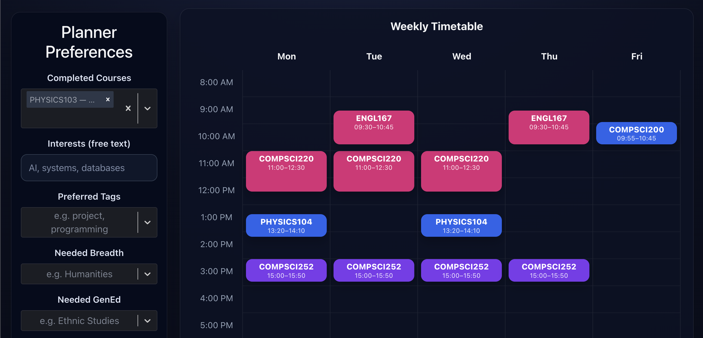

# CourseFlow

A course scheduler for UW–Madison students. Upload your transcript (or list the courses you've taken), say what you're interested in, and CourseFlow builds the best conflict-free schedules you're actually eligible for, from 4,586 real UW courses.

**Live demo:** https://course-flow-three.vercel.app
**API:** https://courseflow-api-zbc1.onrender.com/health (Render) · https://db0xjuzfjsj0f.cloudfront.net/health (AWS)

> **Heads up:** the website's API runs on Render's free tier, which sleeps after 15 minutes of inactivity. The first request after idle takes ~30–60s; after that it's fast.



---

## What it does

- **Transcript import:** drop in your UW-Madison transcript PDF. It's parsed in the browser (the file is never uploaded), you review what was found, and your completed courses, credits, and major fill in automatically.
- **Prerequisite-aware:** only suggests courses you're eligible for, using UW's real AND/OR prerequisite rules and recognizing cross-listed courses (E C E 354 = COMP SCI 354).
- **Ranked schedules:** returns the 50 best conflict-free schedules in your credit range, scored on your interests, your major, and the breadth/gen-ed requirements you still need.
- **Weekly calendar + course list:** click any course for its description, credits, meeting times, and a prerequisite checklist showing what you've already met.
- **Lock or exclude courses:** keep a course in every schedule, or never see it again; schedules regenerate instantly.
- **Honest about data gaps:** courses without published meeting times show as "time not listed" instead of being dropped, and estimated credits are marked "~3 cr".

Course data (listings, prerequisites, meeting times, descriptions, historical grades) comes from [uw-coursemap-data](https://github.com/twangodev/uw-coursemap-data) via a custom ETL script.

## How it works

`POST /plan` runs a four-step pipeline:

1. **Filter:** drop courses you've taken, courses whose prerequisite tree you don't satisfy, and courses above your max difficulty.
2. **Score:** points for interest matches in a course's name, tags, or description ("AI" also matches "artificial intelligence"), courses in your major's department, and requirements you still need. Only real matches score, so a schedule can't win by piling up small courses.
3. **Shortlist:** keep the 32 best-ranked courses (plus anything you locked).
4. **Search:** find the top 50 schedules with no time clashes and credits in range.

### The scheduler: backtracking + memoization

The search walks the shortlist deciding *skip* or *take (in a section that fits)* for each course. Plain backtracking explodes: 33 courses give up to 1.8 million valid schedules, and finding the true top 50 by checking them all took up to **26 seconds**.

Different picks often lead to the same situation (e.g. CS 400 or STAT 324, both MWF 9:55 and 3 credits), and from there the best way to finish is identical. So the search memoizes on what actually determines the future: the next course, credits so far, a bitmask of occupied time slots, and a bitmask of requirements already covered. Each state's top-50 completions are computed once and reused.

| Scenario (33 courses) | Exhaustive | Memoized | Speedup |
|---|---|---|---|
| No preferences, 12–18 cr | 13.9 s | 154 ms | 90× |
| Humanities + Ethnic Studies, ≤15 cr | 4.4 s | 60 ms | 73× |
| Natural + Bio Science, 15–18 cr | 26.3 s | 396 ms | 66× |

[`backend/src/scripts/benchmark.ts`](backend/src/scripts/benchmark.ts) runs both and checks the top-50 scores are identical; CI runs it on every push.

**Bounding memory.** Each cached state holds up to 50 partial schedules, so broad queries over a big shortlist can create hundreds of thousands of states: 40 courses reached 550k states and ~400 MB, which crashed the 512 MB server. The search now has a state budget (100k); if a query exceeds it, it retries with a smaller shortlist (32 → 26 → 20). Worst case is now ~310 ms and ~100 MB; focused queries take ~10 ms.

### Prerequisite trees

UW prerequisites are AND/OR rules, e.g. CS 540: *(CS 300, 320 or 367) and (MATH 211, 217, 221 or 275)*. The ingest turns the dataset's syntax tree into a clean tree of course codes, handling bare numbers ("367" means the same subject as the previous course), courses written as text ("COMP SCI 367"), and non-course conditions (class standing is assumed met; instructor consent and program-only routes aren't). Eligibility is then a short recursive check: AND means all, OR means any.

### Transcript parsing

[`frontend/src/transcript`](frontend/src/transcript) uses **pdf.js** (in a Web Worker, loaded only when someone uploads) to get every text fragment with its page position. The UW transcript is a rotated landscape page with two columns of terms, so the parser rebuilds the table itself: rows by matching height, cells by the nearest column header. It handles transfer-credit blocks nested inside a term, wrapped titles and course numbers, in-progress courses, retakes, and generic transfer credit. Tested with Vitest on a synthetic transcript; no real student data is in the repo.

## Architecture

```
┌──────────────────────┐   HTTPS/JSON    ┌───────────────────────────┐
│  React + Vite (TS)   │ ──────────────▶ │  Express + Node (TS)       │
│  Vercel              │ ◀────────────── │  Docker on Render and AWS  │
│                      │                 │                            │
│  TanStack Query      │                 │  catalog in memory (4.6k)  │
│  pdf.js (transcript) │                 │  filter → score → search   │
└──────────────────────┘                 └───────────────────────────┘
                                                      ▲
                                                      │ npm run ingest (offline)
                                           ┌──────────┴──────────┐
                                           │  uw-coursemap-data  │
                                           └─────────────────────┘
```

**Frontend** (`frontend/`): React 19, Vite, TypeScript. TanStack Query for server state, react-select for pickers, pdf.js for transcripts. A pure HTTP client of the backend.

**Backend** (`backend/`): Express + TypeScript. Routes:
- `GET /health`: liveness probe
- `GET /courses`: code and name of every course (for the course picker)
- `GET /courses/meta`: breadths, gen-eds, and the most common tags
- `POST /plan`: runs the planning pipeline; accepts completed courses, interests, major, requirements, credit range, and locked/excluded courses

The catalog (`backend/data/courses.json`) is committed and loaded into memory at startup: it's read-only and only changes when the ingest is re-run, so there's no database. A repository interface keeps the data source swappable.

## Running locally

Prereqs: Node 20+, npm.

```bash
# 1. Backend
cd backend
npm install
npm run dev          # http://localhost:3001

# 2. Frontend (new terminal)
cd frontend
npm install
npm run dev          # http://localhost:5173
```

The catalog is committed, so no ingest step is needed to run the app.

Checks:

```bash
cd frontend && npm test                               # transcript parser tests
cd backend && npx ts-node src/scripts/benchmark.ts    # scheduler vs. exhaustive search
```

### Regenerating the catalog

See [`backend/data/README.md`](backend/data/README.md) for the sparse clone of uw-coursemap-data and `npm run ingest`, which rewrites `data/courses.json` and `data/subjects.json`.

## Deployment

Every push to `main` deploys everywhere: Vercel and Render via their GitHub integrations, AWS via GitHub Actions.

### Frontend → Vercel

Connect the repo at https://vercel.com/new with `frontend/` as the root, and set `VITE_API_BASE_URL` to the API URL.

### Backend → Render

Render builds `backend/Dockerfile` directly: **Web Service**, root directory `backend`, runtime *Docker*, env vars `NODE_ENV=production`, `PORT=3001`, `CORS_ORIGIN=https://<your-vercel-url>`.

### Backend → AWS

The same image also runs on AWS, defined in [`infra/aws/courseflow.yaml`](infra/aws/courseflow.yaml) (CloudFormation):

```
GitHub Actions ──OIDC──▶ ECR (image) ──SSM──▶ EC2 t3.micro: nginx ─▶ blue/green containers
                                                   ▲                        │
                                     CloudFront (HTTPS) ◀─ public           └─▶ CloudWatch Logs
```

- **EC2** runs the container behind nginx; the security group only admits CloudFront, and there's no SSH. **CloudFront** provides HTTPS.
- **CI/CD** ([`.github/workflows/ci-deploy.yml`](.github/workflows/ci-deploy.yml)): every push/PR typechecks, tests, lints, builds, and checks the scheduler against exhaustive search. Pushes to `main` then build the image, push it to **ECR**, and roll it out through **SSM Run Command** using [`infra/aws/remote-deploy.sh`](infra/aws/remote-deploy.sh): start the new container in the idle slot, wait for `/health`, switch nginx, then remove the old one, so there's no downtime. GitHub authenticates with **OIDC**; no AWS keys are stored anywhere in GitHub.
- **CloudWatch Logs** collects container output (`/courseflow/backend`).

```bash
# Create or update the stack
aws cloudformation deploy --region us-east-1 --stack-name courseflow \
  --template-file infra/aws/courseflow.yaml --capabilities CAPABILITY_NAMED_IAM

# Tear it down
aws cloudformation delete-stack --region us-east-1 --stack-name courseflow
```

## Tech stack

| Layer | Tools |
|---|---|
| Frontend | React 19, TypeScript, Vite, TanStack Query, react-select, pdf.js |
| Backend | Node, Express, TypeScript |
| Data | uw-coursemap-data, ingested offline into a committed JSON catalog |
| Testing / CI | Vitest, scheduler benchmark, ESLint, GitHub Actions |
| Hosting | Vercel (frontend), Render (API), AWS EC2 + ECR + CloudFront + CloudWatch (API, via CloudFormation) |

## Known limitations

- **Meeting times:** the source data has them for only ~300 courses; the rest are suggested as "time not listed" and can't be checked for clashes.
- **Credits:** estimated (3) for courses the source has no credit count for, marked "~3 cr".
- **Lectures only:** labs and discussion sections aren't modeled yet.
- **Shortlist:** the search is exact within the top 32 ranked courses (fewer for very broad queries), so ranking quality matters.

## Roadmap

- Live section times from UW's Course Search & Enroll, so every course can go on the calendar
- Labs and discussion sections alongside lectures
- Saved schedules and user accounts (the point where a database earns its place)
- Meaning-based interest matching instead of keywords

## License

MIT — do what you want.
